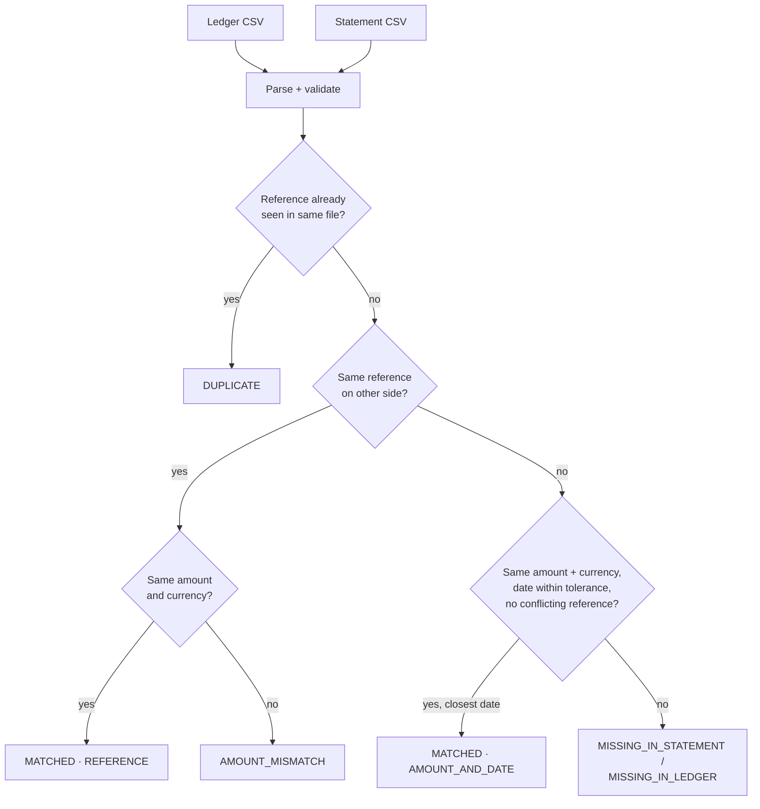

# reconciliation-service

Daily reconciliation between an internal ledger and a bank settlement statement, built with
Java 17 and Spring Boot. Upload both CSV files, get back what matched, what differs, and what
is missing on either side — with an exceptions report operations can work through.


It complements [payment-ledger-service](https://github.com/marvinds1/payment-ledger-service):
the ledger records money movements, this service proves that the bank saw the same movements.

## Highlights

| Concern | How it is handled |
|---|---|
| Explainable matching | Deterministic two-pass matcher: by reference first, then by amount + currency within a value-date tolerance (settlement often lands a day later). Every item records *which rule* paired it. |
| No false pairs | Amount-based pairing is one-to-one, prefers the closest date, and never pairs two entries carrying different non-empty references. |
| Completeness | Every input row ends up in exactly one result (property-style test over 400 random rows). |
| Outcomes | `MATCHED`, `AMOUNT_MISMATCH` (with signed difference), `MISSING_IN_STATEMENT`, `MISSING_IN_LEDGER`, `DUPLICATE`. |
| Idempotent uploads | The run is keyed by a SHA-256 of both files and the tolerance (unique constraint). Re-uploading returns the original run with `Idempotent-Replayed: true`, also under concurrent uploads (`ON CONFLICT DO NOTHING`). |
| Strict input validation | Header check, ISO 4217 currency, `YYYY-MM-DD` dates, row limit. Amounts are converted to integer minor units using the currency's exponent; more decimals than the currency allows is rejected, never rounded. All bad rows are reported with line numbers. |
| Large results | Items are paged with keyset pagination (`afterId`); the exceptions CSV is streamed page by page instead of loading everything into memory. |
| Schema | Flyway migrations, `CHECK` constraints on statuses, indexed by `(run_id, status, id)`. |

## Security, performance and concurrency

| Risk | Guard |
|---|---|
| Unauthenticated access | `X-API-Key` required on `/api/**` when `RECON_API_KEYS` is set (comma-separated, ≥16 chars, several keys for rotation), compared in constant time. Health stays public. API responses carry `Cache-Control: no-store` and `X-Content-Type-Options: nosniff`. |
| CSV / formula injection | References come from uploaded files and end up in a CSV that operations opens in Excel. Values starting with `=`, `+`, `-`, `@`, tab or CR are prefixed with `'` so they are never evaluated as formulas (OWASP guidance). |
| Duplicate / concurrent uploads | Runs are keyed by a SHA-256 of both files and the tolerance with a unique constraint and `INSERT … ON CONFLICT DO NOTHING`. Tested with 8 simultaneous identical uploads: exactly one `201`, the rest replay the same run. |
| Overload | A bulkhead (`RECON_MAX_CONCURRENT_RUNS`, default 4) caps how many runs parse and match at once; extra requests get `503` with `Retry-After` instead of exhausting memory. Upload size (20 MB per file), row count (200k) and page size (500) are limited. |
| Holding DB connections | Parsing and matching happen outside the transaction; only the inserts are transactional. Pool size, connection timeout and a 30s query timeout are bounded. |
| Quadratic matching | Pass 2 indexes candidates by amount, then date, then whether they carry a reference, so a file full of identical amounts (fees, standing orders) stays linear. 200k entries with the same amount match in ~0.4s in a unit test. |
| Slow batch inserts | PostgreSQL JDBC `reWriteBatchedInserts=true` turns batches into multi-row inserts. |

Measured end to end on an M-series laptop (local PostgreSQL in Docker): two files of 100k and 97k
rows (~3.7 MB each) are parsed, matched and persisted in **~1.5 s**, versus ~2.9 s without batch
rewriting. Exporting 3k exceptions as CSV takes ~70 ms.

## How matching works



Example with the files in [`samples/`](samples) and a tolerance of 1 day:

| Ledger | Statement | Result |
|---|---|---|
| `TRF-1001` −1,500,000.00 | `TRF-1001` −1,500,000.00 | `MATCHED` by reference |
| `TRF-1002` −250,000.00 | `TRF-1002` −255,000.00 | `AMOUNT_MISMATCH`, difference −5,000.00 |
| `DEP-2001` +5,000,000.00 on 2 Nov | *(no reference)* +5,000,000.00 on 3 Nov | `MATCHED` by amount and date |
| `TRF-1004` | `TRF-1004` twice | `MATCHED` + `DUPLICATE` |
| `TRF-1006` USD | `TRF-1006` USD, one day later | `MATCHED` by reference |
| `TRF-1003`, `TRF-1005` | — | `MISSING_IN_STATEMENT` |
| — | Admin fee −6,500.00 | `MISSING_IN_LEDGER` |

## API

| Method | Path | Description |
|---|---|---|
| `POST` | `/api/v1/reconciliations` | Multipart `ledgerFile` + `statementFile`, optional `dateToleranceDays` (0–31, default 1) |
| `GET` | `/api/v1/reconciliations/{id}` | Run summary |
| `GET` | `/api/v1/reconciliations/{id}/items?status=&afterId=&limit=` | Items, filter by one or more statuses, keyset pagination |
| `GET` | `/api/v1/reconciliations/{id}/exceptions.csv` | Every non-matched item as CSV |

File format (UTF-8, optional BOM, `description` optional):

```csv
reference,value_date,amount,currency,description
TRF-1001,2026-11-02,-1500000.00,IDR,Transfer to supplier A
```

```bash
curl -s -H "X-API-Key: $RECON_API_KEY" \
     -F ledgerFile=@samples/ledger.csv -F statementFile=@samples/statement.csv \
     localhost:8080/api/v1/reconciliations
```

```json
{
  "id": "3f1c…",
  "ledgerFileName": "ledger.csv",
  "statementFileName": "statement.csv",
  "dateToleranceDays": 1,
  "summary": {
    "ledgerEntries": 7, "statementEntries": 7,
    "matched": 4, "amountMismatch": 1, "missingInStatement": 2,
    "missingInLedger": 1, "duplicate": 1, "exceptions": 5
  },
  "createdAt": "2026-11-23T04:10:00Z"
}
```

Errors use RFC 7807 `application/problem+json` with a `code` (`INVALID_FILE`, `INVALID_REQUEST`,
`RUN_NOT_FOUND`, `TOO_MANY_RUNS`, `UNAUTHORIZED`); `INVALID_FILE` lists the offending lines. OpenAPI UI: `/swagger-ui.html`.

## Running locally

Requirements: Java 17, Maven, Docker.

```bash
docker compose up --build        # PostgreSQL + the service on :8080
mvn verify                       # unit tests + integration tests (Testcontainers PostgreSQL)
```

Configuration: `RECON_API_KEYS` (authentication is off with a startup warning when empty — local
development only), `RECON_MAX_CONCURRENT_RUNS`, `DB_URL`, `DB_USERNAME`, `DB_PASSWORD`, `DB_POOL_SIZE`.

Or run Postgres from compose and the app from your IDE: `docker compose up postgres`, then
`mvn spring-boot:run`.

## Project layout

```
src/main/java/io/github/marvinds1/reconciliation/
  domain/        Entry, Matcher (pure, no Spring), MatchResult, Summary
  csv/           EntryCsvParser, InvalidFileException
  persistence/   JdbcTemplate repository, run/item read models
  service/       ReconciliationService (hashing, idempotency, transaction)
  web/           REST controller, API key filter, problem+json error handling
src/main/resources/db/migration   Flyway scripts
samples/                          Example ledger and statement files
```

## Roadmap

- Many-to-one matching (one bulk settlement line covering several ledger entries).
- Fixed-width and ISO 20022 `camt.053` statement parsers next to CSV.
- Workflow on exceptions: assign, comment, resolve, with audit trail.
- Pull the ledger side directly from payment-ledger-service instead of a CSV export.
- Scheduled runs and a Prometheus metric for unresolved exceptions.

## License

MIT
